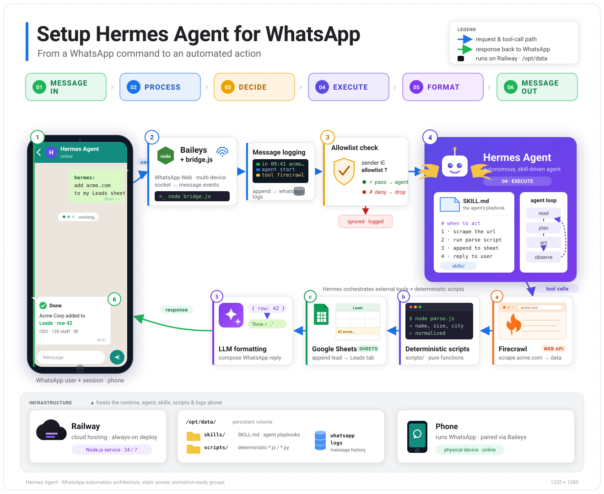
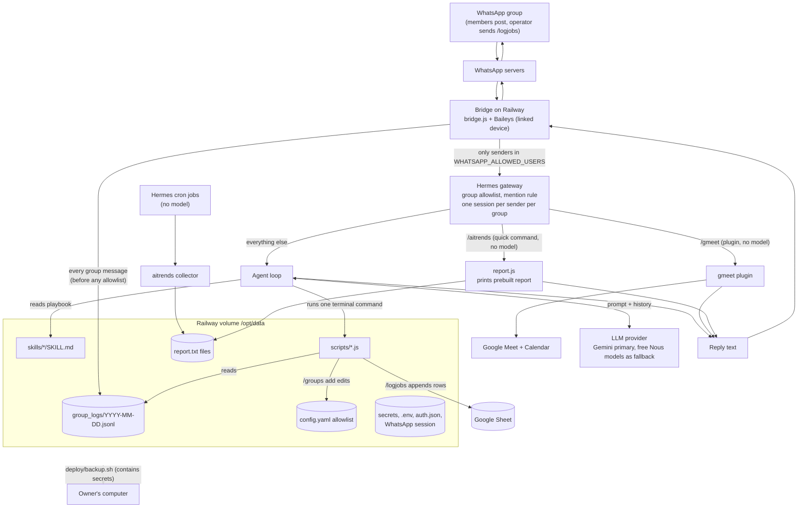

# Elonbot: a WhatsApp group bot on Hermes Agent

Elonbot is a WhatsApp bot that sits in group chats and runs a few commands on
request. Its main job is `/logjobs`: it finds the job posts people shared in a
group that day and adds them to a Google Sheet. It can also summarise a day of
group chat, make Google Meet links, and post a weekly report on AI news.

It runs on [Hermes Agent](https://github.com/NousResearch/hermes-agent), an
open-source AI agent by Nous Research, hosted on [Railway](https://railway.com).
Hermes is not included here. This repo holds only the parts written for this
bot: skills, scripts, a plugin, a small bridge patch, example config and
deployment notes.

This is a personal deployment shared as a reference. Parts of it are specific
to one setup (India time zone, one Google account). Read [Risks and lessons learned](#risks-and-lessons-learned)
before running anything like it.

## Contents

- [How it works, in plain words](#how-it-works-in-plain-words)
- [Architecture](#architecture)
- [Walk-through: one /logjobs message](#walk-through-one-logjobs-message)
- [Commands](#commands)
- [What is in this repo](#what-is-in-this-repo)
- [Deploying](#deploying)
- [Design choices](#design-choices)
- [Risks and lessons learned](#risks-and-lessons-learned)
- [Tests](#tests)
- [Not included](#not-included)

## How it works, in plain words

The bot uses a normal WhatsApp number, linked to a server the same way you link
WhatsApp Web on a laptop. A small program on the server (the "bridge") reads
everything that arrives on that number. It saves group messages to a log file
for each day and passes messages from approved people to Hermes.

Hermes is the "brain". It keeps a separate conversation memory for each person
in each group, sends the conversation to an AI model, and lets the model use
tools such as running a script on the server. Each command has a short written
playbook (a `SKILL.md` file) that tells the model exactly which script to run
and what to reply.

The scripts do the real work: reading the log, spotting job posts, writing to
the Google Sheet. They print a short result, and the bot sends that back to the
group. Some commands skip the AI model entirely and run code directly, which is
faster, cheaper and cannot be misreported.

Everything lives on one persistent disk on Railway (`/opt/data`). A backup
script copies the important parts to the owner's computer.

## Architecture



The poster above shows the general Hermes-on-WhatsApp pattern with an example
command. The diagrams below show this bot's actual parts.



Plain-text version:

```
 WhatsApp group
      |
      v
 WhatsApp servers
      |
      v
 +---------------------------- Railway service, volume /opt/data ---------------------------+
 |                                                                                          |
 |  Bridge (bridge.js + Baileys) --every group message--> group_logs/YYYY-MM-DD.jsonl       |
 |      |                                                        ^                          |
 |      | allowed senders only                                   | read by scripts          |
 |      v                                                        |                          |
 |  Hermes gateway (group allowlist, one session per sender per group)                      |
 |      |-- /gmeet ---------> gmeet plugin (no model) ---------> Google Meet / Calendar      |
 |      |-- /aitrends -> report.js (no model) <---- report.txt <---- cron jobs               |
 |      |-- anything else --> agent loop <---> LLM provider (Gemini, free fallbacks)        |
 |                               |                                                          |
 |                               +--> SKILL.md playbook --> one script --> Google Sheet     |
 |                                                                    \--> config.yaml      |
 |      reply text <------------------------------------------------------------------      |
 |  secrets/, .env, auth.json, whatsapp/session (WhatsApp login)                            |
 +------------------------------------------------------------------------------------------+
      |                                              |
      v                                              v  deploy/backup.sh (contains secrets)
 reply in the WhatsApp group                     owner's computer
```

## Walk-through: one /logjobs message

1. During the day, people in an allowlisted group share job posts: LinkedIn
   links, or typed messages like "Hiring: Backend Engineer, Pune. Apply:
   jobs@example.com".
2. The bridge receives each message and appends one line to that day's log
   file: time, group ID, sender ID, display name, text. (See the privacy notes
   below: this happens for every group, allowlisted or not.)
3. The operator sends `/logjobs today` (or `@ElonBot logjobs today`) in the
   group.
4. The bridge checks the sender is on `WHATSAPP_ALLOWED_USERS`. Anyone else is
   dropped here. Hermes then checks the group is on `group_allow_from`.
5. Hermes loads that sender's session for that group and gives the model the
   `logjobs` playbook. The playbook says: run exactly
   `node /opt/data/scripts/logjobs-run.js today` and reply with the one line it
   prints, nothing else.
6. `logjobs-run.js` runs two scripts in sequence:
   - `logjobs-extract.js` reads the day's log, keeps messages that look like
     job posts, fetches the public preview text of LinkedIn links, guesses
     title, company, location and type, and writes `jobs-preview.csv`.
   - `logjobs-append-sheet.js` signs in to Google with a service account,
     skips messages already sent (tracked by message ID in a small JSON file),
     and appends new rows to the `jobs` tab.
7. The script prints one sentence, for example
   "Added 5 new jobs from today to the sheet (2 more were already there)."
8. The model copies that sentence as the reply. The bridge sends it to the
   group.

No message text reaches the AI model during `/logjobs`. The model only sees the
command and the one-line result.

## Commands

| Command | What it does | Uses the AI model? |
|---|---|---|
| `/logjobs today` or `/logjobs YYYY-MM-DD` | Adds that day's job posts from the group logs to the Google Sheet | Only to run the script and paste its line |
| `/chat-summary` (or "summarise today's chat") | Summarises a group's messages for a day or up to 7 days | Yes. The group's messages are sent to the model. |
| `/groups` | Lists groups the number is in, marked allowlisted or not | Only to run the script |
| `/groups add <name>` | Adds one group to the allowlist (cannot remove). Needs `/restart`. | Only to run the script |
| `/capital-flow-report [week]` | Weekly US and India funding digest written for product managers | Yes. A script gathers headlines from RSS; the model writes the report from that digest. |
| `/gmeet instant` or `/gmeet 9pm 18-10-2026` | Makes an open Google Meet link, optionally on the owner's calendar | No (Hermes plugin) |
| `/aitrends` | Weekly "AI This Week" digest | No at request time. The weekly cron job calls Gemini directly to draft it. |

Hermes built-ins this deployment relied on: `/model <name> --global` (change
the model for every chat, since plain `/model` changes only the current
session), `/restart`, `/reload-skills`, `/stop` and `/new`.

## What is in this repo

| Path | What it is |
|---|---|
| `skills/` | Hermes skill playbooks (`SKILL.md`), one folder per command |
| `scripts/` | Node.js scripts the skills run. Copy to `/opt/data/scripts/`. |
| `scripts/aitrends/` | `/aitrends`: RSS collector, Gemini selection and writing, number and name checker, tests |
| `plugins/gmeet/` | Hermes plugin for `/gmeet`, plus `test_gmeet.py` |
| `tools/gmeet-auth.js` | One-time Google OAuth on your own computer to create the `/gmeet` token |
| `patches/bridge-group-log.md` | The lines added to Hermes's WhatsApp bridge to write daily group logs |
| `config/config.example.yaml` | The Hermes config keys this bot changed, with placeholders |
| `.env.example` | Environment variable names (no values) |
| `deploy/` | Railway notes, the backup script, the job-data archive script |
| `tests/logjobs/` | Offline tests for job detection and company guessing |
| `docs/architecture.svg` | Architecture poster |

## Deploying

Short version, full steps in [deploy/RAILWAY.md](deploy/RAILWAY.md):

1. Run the `nousresearch/hermes-agent` image on Railway with a volume at
   `/opt/data` and the start command
   `/bin/sh -c "exec hermes gateway run --no-supervise"`.
2. Set up Hermes and pair a WhatsApp number as a linked device.
3. Merge `config/config.example.yaml` into the server config and fill `.env`.
4. Copy `skills/`, `scripts/` and `plugins/` onto the volume.
5. Apply the bridge patch, add the Google credentials, restart.
6. Set restart policy to Always, and schedule the backup.

Requirements: Node.js 22.5 or newer for the scripts (the collectors use the
built-in `node:sqlite`; there are no npm dependencies), Python 3 for the plugin, a Google Cloud project for
Sheets and Meet, and an API key for your model provider.

## Design choices

- **Scripts decide, the model relays.** Each skill runs one command and pastes
  one line. Job detection, deduplication and Sheet writes are plain code that
  behaves the same every time.
- **No model where none is needed.** `/gmeet` is a plugin, and the two weekly
  reports are prebuilt by cron and printed by quick commands. These replies
  are fast, free and cannot be invented by a model.
- **Add-only access changes.** `/groups` can add a group to the allowlist and
  can never remove one. It backs up `config.yaml`, verifies the write, and
  restores the backup if verification fails.
- **Facts checked by code.** The `/aitrends` writer rejects any generated line
  whose numbers or names do not appear in the source items, retries once, then
  drops the line.

## Risks and lessons learned

Statements marked *(verified in code)* were checked in the files in this repo
or in the running bridge. *(Observed)* means it happened in this deployment
and is recorded in the operator's notes. *(Inference)* is reasoning that was
not tested.

### WhatsApp account ban and Terms of Service

- The bridge uses [Baileys](https://github.com/WhiskeySockets/Baileys), an
  unofficial library that speaks the WhatsApp Web protocol. Meta's official
  route for bots is the WhatsApp Business Platform. *(verified in code)*
- WhatsApp's terms restrict unofficial clients and automated use.
  *(Inference: check the current terms yourself.)* Numbers using unofficial
  clients can be banned without warning. This deployment did not record a
  ban, which says nothing about the risk.
- The bot runs on a real number that is also someone's WhatsApp account. A ban
  would take that account with it. Use a number you can afford to lose.

### Privacy of group messages

- **The bridge patch logs every group the number is in.** The log
  call runs before any allowlist check, so the server stores messages from
  every group the number belongs to, from every member. In the running
  deployment the logs held messages from 4 groups that were not allowlisted.
  *(verified in code and in the deployment)* Nothing deletes these logs.
- **Group members did not sign up for this.** Logs keep each sender's WhatsApp
  ID (phone number or LID), display name and text. Tell the group a bot is
  recording, and get the group admin's agreement before adding it.
- **The Sheet holds personal data.** `/logjobs` writes the poster's display
  name and a 240-character excerpt of their message. *(verified in code)*
- **Chat text goes to the model provider.** `/chat-summary` sends up to 500
  messages from the chosen group to the LLM. *(verified in code)* With a free
  API tier, the provider may use prompts for training and human review.
  *(Inference based on the provider's published free-tier terms at the time;
  check yours.)*
- **Cross-group reading.** `/chat-summary` can summarise any logged group by
  name, from inside a different group. Anyone allowed to trigger the bot can
  read a summary of a group they are not in. *(verified in code)*

### Who can trigger it

- Three gates apply: the bridge drops senders not in
  `WHATSAPP_ALLOWED_USERS` (unless `WHATSAPP_DM_POLICY=pairing`) *(verified in
  code)*; Hermes ignores groups not in `group_allow_from`; and with
  `WHATSAPP_REQUIRE_MENTION=true` the bot answers only when mentioned or sent a
  command.
- Keep `WHATSAPP_ALLOWED_USERS` to the operators. Anyone on it can run
  `/groups add`, which changes who the bot listens to. *(verified in code)*
- The group allowlist is read only at boot. Editing it does nothing until a
  restart. *(Observed)*

### Prompt injection from group members

- Group members cannot trigger the bot, but their text reaches the model when
  the operator asks for a summary. The model in this setup can run terminal
  commands on the server. A member could write instructions aimed at the bot
  inside an ordinary message. *(Inference: not observed, not tested.)*
- The skills tell the model to run only one named script and never touch
  secrets. A model can ignore those instructions; no code enforces them.
- Old replies in a chat's history also act like instructions: the model copied
  stale `/logjobs` results from earlier turns. *(Observed)*

### The model claiming it ran a tool

- In one `/logjobs` run the model ran the extract step, skipped the Sheet step,
  and replied with an invented Sheet result copied from earlier history.
  *(Observed)*
- Fix used: one wrapper script runs both steps and prints one sentence. A
  sentence only exists if the scripts ran. Even so, check writes against the
  data itself: the Sheet, or the modified time of `jobs-sent-ids.json`.
- `/groups add` still relies on the model to run the script and paste its
  JSON. Confirm with `/groups` (list) afterwards. *(Inference)*

### Cost, rate limits and model churn

- Free models hit rate limits. A `429` reply made Hermes wait 600 seconds
  before retrying, so the bot looked dead for 10 minutes; one provider asked
  for a 4.7-hour wait. *(Observed)*
- Free models get withdrawn. When the primary free model ended, the whole bot
  failed until the config changed. A model listed as free in the provider's
  catalogue still returned "not found". Test a model with a real call before
  switching to it. *(Observed)*
- Fix used: a paid primary model plus `fallback_providers`. Fallback also
  triggers on "model not found". *(Observed)*
- Hermes estimated about $0.011 per `/logjobs` run at list price on the
  primary model. Set a budget limit with your provider. *(Observed estimate)*
- Hosting ran about $5 a month. The service cannot sleep, because WhatsApp
  needs an open connection. *(Observed)*

### History bloat

- Hermes never resets a chat on a timer, so history grows forever. By default
  it compresses history only at half the model's context window, which on a
  very large window never happens. One group session reached 106 messages and
  68k tokens, and the model began replying with nonsense such as "No response
  requested." *(Observed)*
- Fix used: `compression.threshold_tokens: 24000` and `protect_last_n: 6`.
  Sessions are per sender per group, so this matters for every person who
  uses the bot.

### Crash loops and restarts

- `/restart` in chat makes the gateway exit with code 75 so Railway relaunches
  it. With the "On failure" policy Railway allows 10 relaunches per
  deployment; the 11th exit left the bot stopped. *(Observed)*
- A `/restart` sent while a turn was waiting out a `429` deferred, tore down
  the bridge, and a following `/stop` exited the process, which Railway marked
  as crashed. *(Observed)*
- Fix used: restart policy "Always", fallback models, and patience with
  `/restart` while a turn is stuck.

### Secrets on a hosted volume

- The volume holds the WhatsApp login, `.env` with API keys, provider auth,
  the Google service-account key and the Meet OAuth token. Anyone with access
  to the Railway project, or to `railway ssh`, can read all of it.
- The model can run terminal commands on the same filesystem. Hermes redacts
  key-like strings in output by default (per its config comments), but that is
  pattern matching. Keep provider keys scoped and capped.
- `railway ssh` runs as root. Files root creates must be `chown`ed back to the
  `hermes` user; a root-owned CSV once made the bot fail and then improvise its
  own workaround files. *(Observed)*
- An expired or revoked Nous login can only be fixed from an interactive
  terminal. See [deploy/RAILWAY.md](deploy/RAILWAY.md). *(Observed)*

### Backups contain everything

- `deploy/backup.sh` copies the WhatsApp login, `.env`, auth files, Google
  keys and all group logs. Anyone with a backup file can act as the bot's
  WhatsApp number. Store backups like passwords, keep them out of cloud sync
  and out of git. `.gitignore` excludes `backups/` and `*.tar.gz`.

### Smaller lessons

- Hermes treats outgoing text as Markdown: `*x*` arrives in WhatsApp as
  italic and `**x**` as bold. Scripts write bold as `**x**`. *(verified in code)*
- Hermes shows a group to the model as a bare ID number, never its name, so
  scripts resolve names through the bridge's `/chat/<id>` endpoint and cache
  them. *(verified in code)*
- Plain `/model` changes the model for one sender's session in one group and
  survives restarts. Use `/model <name> --global`. *(Observed)*
- Hermes's setup wizard can reset the default model. Re-check after running
  it. *(Observed)*

## Tests

```bash
node tests/logjobs/test-looksjob.js
node tests/logjobs/test-company.js
python plugins/test_gmeet.py
node scripts/aitrends/test/run-all.js
```

The first three pass as published. The `aitrends` suite originally ran against
recorded web pages in `test/fixtures/`. Those recordings are third-party
content and are not included, so `aitrends/test/test-collect.js` and
`aitrends/test/test-rss.js` fail until you record your own fixtures. The other
test files pass without fixtures.

None of the scripts have been run against a live WhatsApp group or Sheet from
this repo copy. They are the same files that ran in the deployment, apart from
the redactions listed below.

## Not included

- Hermes Agent itself and its WhatsApp bridge. Get them from
  [NousResearch/hermes-agent](https://github.com/NousResearch/hermes-agent).
- Any secret, login, token, session, backup, log, chat history, database or
  Sheet.
- Group names, group IDs, phone numbers and Sheet IDs. Examples in the skills
  use made-up values.
- Recorded test fixtures (third-party web pages).
- The `/pmjobtrend` job-trend collector. It scraped LinkedIn's public job pages and Naukri, which restrict automated access in their terms, so it was left out of this repo.

Changes made for publishing: the Sheet ID is no longer hardcoded
(`logjobs-append-sheet.js` now reads `SHEET_ID` from the environment or from
`/opt/data/.env`), the service-account path defaults to
`/opt/data/secrets/google-sa.json`, the archive script's destination is
configurable, and real group names and messages in examples and tests were
replaced with invented ones.

## License

MIT. See [LICENSE](LICENSE). Hermes Agent and Baileys have their own licenses.
